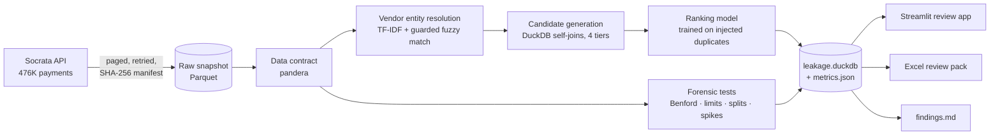

# Spend Leakage Finder

[](https://github.com/janishkumar/spend-leakage-finder/actions/workflows/ci.yml)

**Find the duplicate payments, vendor-master duplicates and split purchases hiding in an accounts-payable ledger, and hand a reviewer a ranked, evidence-backed queue they can clear in a week.**

Demonstrated end to end on a real public ledger: **476,336 City of Chicago vendor payments** ($119.5B, voucher-level from 2022 to Oct 2026, [data.cityofchicago.org `s4vu-giwb`](https://data.cityofchicago.org/d/s4vu-giwb)). No client data, no synthetic ledger.

---

## The business problem

Every AP team pays some invoices twice. The usual causes are a vendor set up twice in the vendor master, an invoice re-keyed with a typo in the invoice number, or two digits transposed in the amount. Recovery-audit firms find these after the fact and keep a share of what's recovered.

The standard ERP control, "flag same vendor + same amount", doesn't work at scale. On this ledger it produces **58,564 pairs**, most of them routine repeat payments. Ranked by that rule, the top 100 contained none of the duplicates planted for testing (details below). Nobody reviews 58,000 pairs.

This project shrinks that list to the few hundred worth a human's time, and shows its evidence for each one.

## Results (from [`docs/findings.md`](docs/findings.md), generated by the pipeline)

| | |
|---|---|
| Payee spellings → resolved vendors | 76,555 → **75,447** |
| Candidate duplicate pairs (4 tiers) | 87,684 |
| Payees scoped out as statutory transfers (pensions, bond trustees, tax) | 867 pairs, $8.3B |
| Injected duplicates the pipeline finds | **93%** |
| **Precision in the top 100**, ranking model vs. the "same vendor + amount" rule | **92% vs 0%** |
| Precision in the top 500 | 62% vs 2% |
| PR-AUC | 0.52 vs 0.04 |

Real examples from the top of the queue (candidates, not confirmed overpayments):

- **CORE MECHANICAL INC**: $5,575.50 and $5,557.50, two days apart, different vouchers (transposed digits)
- **REX 4 INC / REX 4 INC.**: $9,000.00 paid three times on the same day under two vendor-master spellings
- **CHICAGO HEARING SOCIETY / CHICAGO HEARING SOCIETY/A**: same amounts paid under two vendor records, repeatedly

**What a review is worth.** The top 250 suspect payments carry $7.4M of exposure and take about $5K of reviewer time. If 2% confirm, that's $147K recovered; at 5%, $368K. The confirmation rate is an assumption until a client reviews a sample, so the app shows the whole sensitivity range rather than one number.

## How it works



1. **Ingestion.** A full snapshot is pulled from the SODA API with stable pagination and retries, and stored as Parquet with a manifest of row counts and hashes. If the source hasn't changed, the run is a no-op.
2. **Data contract.** Raw rows are mapped to a standard payments schema, validated with pandera. Chicago mixes voucher-level payments with *annual roll-up rows* (a year, no voucher); those are kept and flagged so no detector treats them as payments. A new ledger needs one adapter function.
3. **Vendor entity resolution.** Names are normalised (case, punctuation, legal suffixes, honorifics). Near-duplicates are found by char n-gram TF-IDF nearest neighbours, then verified token by token (see *What didn't work*), and clusters are joined with union-find.
4. **Duplicate candidates**, as DuckDB self-joins within vendor and date windows:
   - **T1**: identical rows (usually split lines; reported as a data-quality flag)
   - **T2**: same vendor and amount, different voucher, within 30 days
   - **T3**: same amount on the same day, to one vendor under two names (vendor-master duplicate)
   - **T4**: amount within 0.5%, or the same digits transposed, within 14 days
5. **Ranking.** No public ledger labels its duplicates, so the model learns from **injected** ones. 3,000 real payments are copied and perturbed the way duplicates actually happen: re-keyed voucher, shifted date, transposed digits, vendor-name typos. A gradient-boosted classifier then learns to separate those from the real candidate pairs, using features such as day gap, amount match, how routine the amount is for that vendor, monthly cadence, and contract/department match. It's evaluated on held-out vendors. Measured precision is a lower bound, because a few real duplicates are probably counted as negatives.
6. **Forensic tests:**
   - Benford's law by department (Nigrini MAD bands)
   - Bunching just under approval limits, measured against non-round control points
   - Split purchases (several under-limit direct vouchers to one vendor within a week)
   - Vendor-month spend spikes by robust z-score

## What didn't work (and what replaced it)

- **Plain fuzzy matching merges different people.** About half of a city's payees are individuals (refunds, settlements). The first pass merged *KENNETH B SMITH* with *KENNETH D SMITH*, *CURTIS MORRIS* with *NORRIS*, and *PARTNERS II* with *PARTNERS XV*: 1,694 merges, and about a third of a 25-pair sample was wrong. The replacement checks names token by token:
  - initials, generational suffixes and Roman numerals must agree
  - the first letter of a token never changes
  - short "brand" tokens must match exactly (GRANT ≠ GRANITE, CTS ≠ CBTS)
  - individuals get a stricter rule than organisations: at most one single-character typo, never at the end of a token (ANDREA ≠ ANDREW)

  That leaves 247 merges, and about 94% look right on two independent 50-pair spot checks. Recall on injected name variants fell to 55%. That trade is deliberate: a false merge *creates* false duplicate candidates, while a missed merge only loses a few.
- **The first ranking model was too good to be true.** PR-AUC was 0.94. The injected copies took voucher numbers from random payments, so their voucher series almost never matched the source's, while real pairs match 99% of the time. That one feature separated the classes on its own (AUC 0.05). Copies now draw from the same voucher series, the feature is gone, and a regression test guards against it. The honest PR-AUC is 0.52.
- **Ranking by expected value surfaced pension contributions.** Multiplying the risk score by the dollar amount put $17–99M statutory pension and bond-trustee instalments at the top: identical, same-day, and entirely legitimate. Those payees are now scoped out, as any AP review would do, and the queue ranks by risk.
- **"No bunching under approval limits" is a real result.** A raw just-below/just-above ratio looks suspicious at $10K (1.32×). Against control points at 0.8× and 1.25× the limit, the lift is only 1.10, so nothing is reported.

## Using it

```bash
make setup          # uv sync
make run            # download the latest snapshot (skipped if unchanged) and run everything (~2 min)
make report         # docs/findings.md + reports/review_pack.xlsx
make app            # Streamlit review app on :8501
make test           # 51 tests, no network, synthetic fixtures
```

The **Excel review pack** is what a reviewer actually works from. It contains the ranked candidates with both sides of every pair, a `reviewer_decision` column, vendor-master duplicates, fuzzy merges for sign-off, split-purchase windows, Benford by department, and the ROI sensitivity table.

To run it on a different ledger, write one `standardise_<source>()` in `src/leakage/contract.py` that returns the standard schema. The detectors, model, report and app don't change.

## Engineering

- **CI** (GitHub Actions): ruff, 51 pytest tests with a coverage gate (94% today), dependency audit, gitleaks secret scan, and a Docker build.
- **CD**: once CI passes on `main`, the image is published to GHCR, tagged by commit SHA and `latest`.
- **Reproducible runs**: candidate order is pinned and every seed is fixed. Two consecutive full runs produce identical `metrics.json`.
- **No hand-typed numbers**: `findings.md`, the review pack and the app all read the same `metrics.json` / `leakage.duckdb`.
- Stack: Python 3.12, uv, DuckDB, pandas, scikit-learn, rapidfuzz, pandera, Streamlit, openpyxl, Docker.

```
src/leakage/
  ingest.py       Socrata snapshots + manifest
  contract.py     standard schema, pandera validation
  vendors.py      normalisation, entity resolution, perturbation eval
  duplicates.py   candidate tiers, pair features, payee scoping
  scorer.py       duplicate injection, training, evaluation
  forensics.py    Benford, limit bunching, splits, spikes
  pipeline.py     end-to-end run -> leakage.duckdb + metrics.json
  report.py       findings.md, Excel review pack, ROI
app/streamlit_app.py
```

## Limitations

- Public data has no invoice numbers or line numbers. Identical rows (T1) are often legitimate split lines, and nothing here is a confirmed overpayment.
- The ranking model is trained on simulated duplicates. It's only as good as the perturbation model, and it hasn't yet been calibrated on reviewer decisions. The `reviewer_decision` column in the pack exists to collect exactly those labels.
- `risk_score` ranks pairs; it is not a probability.

## Roadmap

1. Retrain on reviewer decisions from the first pack (active learning).
2. Add a second ledger to prove the adapter boundary.
3. Spend categorisation into a procurement taxonomy.
4. Scheduled weekly refresh.
